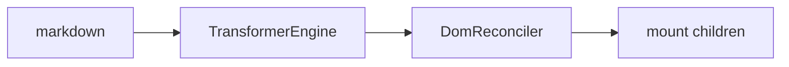

# [[title]]

> [[subtitle]] — 只要预览、不要编辑器 chrome 时用这一层。

---

## 何时用 Renderer

::: tabs
@tab:active 文档站 / 文章页
Markdown → 带主题的 DOM，需要 TOC、代码复制、图片放大。
@tab 自定义外壳
自建布局，只把内容区交给 Renderer。
@tab 不要用
需要工具栏与实时编辑 → 用 [`editor.md`](editor.md)（内部已嵌 Preview → Renderer）。
:::

---

## 最小示例

独立渲染需要自行组装 **Theme + EventBus + Log**，再交给 `Renderer`：

```typescript
import { Renderer, Theme, EventBus, Log } from "penna-markdown/renderer";

const mount = document.getElementById("preview")!;
const root = mount.parentElement!;
mount.classList.add("penna-render");

const log = new Log(false);
const eventBus = new EventBus(false, "[penna]", log);
const theme = new Theme(eventBus, log, root);

const renderer = new Renderer({
  mount,
  theme,
  eventBus,
  logger: log,
});

theme.setTheme("github");
renderer.render("# Hello\n\n**world**");
```

开发本仓库时可直接抄 `demo/modules/renderer/main.ts` / `demo/_common/theme.ts`（`createDemoTheme` 封装了同上组装）。

样式：

```html
<link
  rel="stylesheet"
  href="penna-markdown/penna-theme-github-render.min.css"
/>
```

> [!NOTE]
> `createDemoTheme` 会把皮肤 class 挂到传入的 root 上，并提供顶栏主题控件绑定逻辑。

---

## 构造选项

:::: field-group

::: field mount
@type HTMLElement
@required
预览挂载点（建议带 `penna-render` class）。
:::

::: field theme
@type Theme
@required
主题与事件总线载体。
:::

::: field eventBus
@type EventBus
@required
与 Theme 共用同一总线。
:::

::: field logger
@type Log
@required
日志门面。
:::

::: field inlineParsers
@type Record<number, BaseInlineParser>
@optional
按 priority 注入行内 parser。
:::

::: field blockParsers
@type Record<number, BaseBlockParser>
@optional
按 priority 注入块级 parser。
:::

::: field engines
@type GraphEngines
@optional
外部图表库。配置的项由本地库渲染，**不再请求远程 API**；未配置的仍走默认远程图（`math-api` / `mermaid.ink` / `echarts-api`）。

每项可以是**库实例**、**加载函数**（可返回 ES module，用于懒加载）或 `"global"`（读取 `window.katex / mermaid / echarts`，对应 `<script>` / CDN 引入）。

| 字段 | 库 | 约定 |
|------|----|------|
| `math` | KaTeX | `renderToString(tex, { displayMode, throwOnError, trust })` |
| `mermaid` | Mermaid ≥10 | `render(id, text) → Promise<{ svg }>`，Penna 会以 `securityLevel: "strict"` 初始化 |
| `echarts` | ECharts | `init(dom, theme?)` |

```typescript
new Renderer({
  mount, theme, eventBus, logger,
  engines: {
    math: () => import("katex"),
    mermaid: () => import("mermaid"),
    echarts: "global", // 页面已 <script> 引入 echarts
  },
});
```

行为：只处理尚未水合的占位节点，结果按「源码 + 主题」缓存；明暗切换时 Mermaid / ECharts 按新主题重新渲染（KaTeX 继承文字色）；渲染或加载失败时回退为源码文本（`pre.penna-graph-fallback`）。也可用 `syntaxOptions` 的 `apiHost` / `*ApiHost` 指向自建镜像，`false` 表示禁用远程。

> [!WARNING]
> ECharts 代码块的 option 按「严格 JSON 或对象字面量」解析，**不执行代码**，因此 `formatter: function(){}` 这类函数写法不再支持。
:::

::::

---

## 常用 API

:::: field-group

::: field render
@type (markdown: string, changes?: PennaChangeLineSet[]) => RenderResult
增量优先，失败降级全量。
:::

::: field setEngines
@type (engines: GraphEngines | undefined) => void
热切换外部图表库（`undefined` 恢复远程 API），并用当前 markdown 全量重渲。
:::

::: field renderFull
@type (markdown: string) => RenderResult
强制全量渲染。
:::

::: field append
@type (chunk: string) => RenderResult
在当前文档末尾追加字符。
:::

::: field getToc
@type () => TocItem[]
层级目录树（无 AST 时为空数组）。只统计文档根层级的标题，引用块 / 容器 / 列表项内部的标题不参与。
:::

::: field getTocFlat
@type () => TocFlatItem[]
扁平目录，取值范围同 `getToc`。
:::

::: field getMountedBlocks
@type () => BlockIndex[]
当前挂载块索引。
:::

::: field getStore
@type () => ParserStore | null
最近一次解析的 `ParserStore`。
:::

::: field getMount
@type () => HTMLElement
挂载点。
:::

::: field destroy
@type () => void
释放监听与 lightbox 等。
:::

::::

---

## 增量渲染

编辑场景下 Preview 会 debounce 后调用 `render`，并尽量只更新脏块：



正确性优先：块索引与 DOM 对不齐、脚注牵连等会自动全量重绘。

---

## 相关

- [转换器](transformer.md) · [主题](themes.md) · [扩展语法](extend.md) · [API](api.md)
