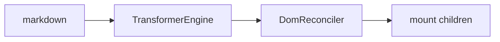

# [[title]]

> [[subtitle]] — 只要预览、不要编辑器 chrome 时用这一层。

---

## 何时用 Renderer

::: tabs
@tab:active 文档站 / 文章页
Markdown → 带主题的 DOM，需要 TOC、代码复制、图片放大。
@tab 自定义外壳
自建布局，只把内容区交给 Renderer。
@tab 不要用
需要工具栏与实时编辑 → 用 [`editor.md`](editor.md)（内部已嵌 Preview → Renderer）。
:::

---

## 最小示例

独立渲染需要自行组装 **Theme + EventBus + Log**，再交给 `Renderer`：

```typescript
import { Renderer, Theme, EventBus, Log } from "penna-markdown/renderer";

const mount = document.getElementById("preview")!;
const root = mount.parentElement!;
mount.classList.add("penna-render");

const log = new Log(false);
const eventBus = new EventBus(false, "[penna]", log);
const theme = new Theme(eventBus, log, root);

const renderer = new Renderer({
  mount,
  theme,
  eventBus,
  logger: log,
});

theme.setTheme("github");
renderer.render("# Hello\n\n**world**");
```

开发本仓库时可直接抄 `demo/modules/renderer/main.ts` / `demo/_common/theme.ts`（`createDemoTheme` 封装了同上组装）。

样式：

```html
<link
  rel="stylesheet"
  href="penna-markdown/penna-theme-github-render.min.css"
/>
```

> [!NOTE]
> `createDemoTheme` 会把皮肤 class 挂到传入的 root 上，并提供顶栏主题控件绑定逻辑。

---

## 构造选项

:::: field-group

::: field mount
@type HTMLElement
@required
预览挂载点（建议带 `penna-render` class）。
:::

::: field theme
@type Theme
@required
主题与事件总线载体。
:::

::: field eventBus
@type EventBus
@required
与 Theme 共用同一总线。
:::

::: field logger
@type Log
@required
日志门面。
:::

::: field inlineParsers
@type Record<number, BaseInlineParser>
@optional
按 priority 注入行内 parser。
:::

::: field blockParsers
@type Record<number, BaseBlockParser>
@optional
按 priority 注入块级 parser。
:::

::: field engines
@type GraphEngines
@optional
外部图表库。配置的项由本地库渲染，**不再请求远程 API**；未配置的仍走默认远程图（`math-api` / `mermaid.ink` / `echarts-api`）。

三种库的 API 不同，分别对应公式字符串、异步 SVG 和 DOM 图表实例。每项可以传库实例、返回实例或 ES module 的加载函数（用于懒加载），或传 `"global"` 读取对应的 `window` 全局变量。

| 配置项 | API 契约 | Penna 的处理方式 |
| --- | --- | --- |
| `math` | KaTeX `renderToString(tex, { displayMode, throwOnError, trust })`，同步返回 HTML 字符串 | 按行内/块级公式设置 `displayMode`，固定 `trust: false`；宿主需额外引入 KaTeX CSS |
| `mermaid` | Mermaid `render(id, text) → Promise<{ svg }>`，异步返回 SVG | 串行调用并生成唯一 id；设置 `securityLevel: "strict"` 和当前主题，不需要宿主另行初始化 |
| `echarts` | ECharts `init(dom, theme?) → chart`，实例提供 `setOption()` / `dispose()` | Penna 在容器上初始化实例、传入解析后的 option，并在主题切换或卸载时释放实例 |

::: tabs
@tab:active KaTeX

KaTeX 同步返回公式 HTML，因此除 npm 模块外还要引入 KaTeX 样式：

```typescript title="katex.ts"
import katex from "katex";
import "katex/dist/katex.min.css";

new Renderer({
  mount, theme, eventBus, logger,
  engines: { math: katex },
});
```

@tab Mermaid

Mermaid 的 `render` 是异步 API。Penna 会初始化安全级别和主题，不要在传入前用 `initialize` 覆盖全局配置：

```typescript title="mermaid.ts"
import mermaid from "mermaid";

new Renderer({
  mount, theme, eventBus, logger,
  engines: { mermaid },
});
```

@tab ECharts

ECharts 先用 `init` 创建 DOM 实例，再由 `setOption` 设置图表数据；这些步骤由 Penna 完成：

```typescript title="echarts.ts"
import * as echarts from "echarts";

new Renderer({
  mount, theme, eventBus, logger,
  engines: { echarts },
});
```

```echarts
{
  title: { text: "无需在配置块里写函数" },
  xAxis: { type: "category", data: ["A", "B", "C"] },
  yAxis: { type: "value" },
  series: [{ type: "bar", data: [12, 24, 18] }]
}
```

@tab `<script>` 全局变量

如果页面已经用 `<script>` 引入库，可按各库自己的全局变量名使用 `"global"`：

```html
<script src="https://cdn.jsdelivr.net/npm/katex/dist/katex.min.js"></script>
<script src="https://cdn.jsdelivr.net/npm/mermaid/dist/mermaid.min.js"></script>
<script src="https://cdn.jsdelivr.net/npm/echarts/dist/echarts.min.js"></script>
```

```typescript
new Renderer({
  mount, theme, eventBus, logger,
  engines: {
    math: "global",    // window.katex
    mermaid: "global", // window.mermaid
    echarts: "global", // window.echarts
  },
});
```

:::

加载函数可以把大型库延迟到第一次出现对应语法时再加载，例如 `mermaid: () => import("mermaid")`。可以只配置其中一项，或混合实例、加载函数和全局变量。

渲染结果按源码与主题缓存；明暗切换时 Mermaid / ECharts 会重新渲染，KaTeX 继承文字颜色。库加载或渲染失败时保留源码文本，不会静默回退到远程 API。可在 `syntaxOptions` 中用 `math_block.apiHost`、`code.mermaidApiHost`、`code.echartsApiHost` 分别指定远程图片服务；显式设置 `false` 可关闭对应远程图。

> [!WARNING]
> ECharts 配置块只接受 JSON 或对象字面量形式的数据，不执行代码；`formatter: function(){}` 这类函数写法不支持。需要 formatter 时，应在宿主代码中构造 option 并通过自定义渲染方案处理，不要把可执行代码放进 Markdown。
:::

::::

---

## 常用 API

:::: field-group

::: field render
@type (markdown: string, changes?: PennaChangeLineSet[]) => RenderResult
增量优先，失败降级全量。
:::

::: field setEngines
@type (engines: GraphEngines | undefined) => void
热切换外部图表库（`undefined` 恢复远程 API），并用当前 Markdown 全量重渲。
:::

::: field renderFull
@type (markdown: string) => RenderResult
强制全量渲染。
:::

::: field append
@type (chunk: string) => RenderResult
在当前文档末尾追加字符。
:::

::: field getToc
@type () => TocItem[]
层级目录树（无 AST 时为空数组）。只统计文档根层级的标题，引用块 / 容器 / 列表项内部的标题不参与。
:::

::: field getTocFlat
@type () => TocFlatItem[]
扁平目录，取值范围同 `getToc`。
:::

::: field getMountedBlocks
@type () => BlockIndex[]
当前挂载块索引。
:::

::: field getStore
@type () => ParserStore | null
最近一次解析的 `ParserStore`。
:::

::: field getMount
@type () => HTMLElement
挂载点。
:::

::: field destroy
@type () => void
释放监听与 lightbox 等。
:::

::::

---

## 增量渲染

编辑场景下 Preview 会 debounce 后调用 `render`，并尽量只更新脏块：



正确性优先：块索引与 DOM 对不齐、脚注牵连等会自动全量重绘。

---

## 相关

- [转换器](transformer.md) · [主题](themes.md) · [扩展语法](extend.md) · [API](api.md)
